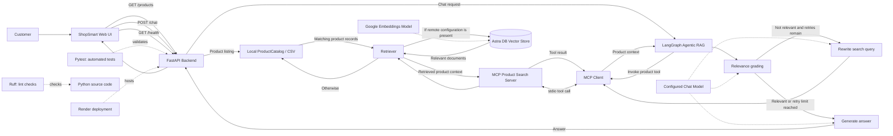

# E-commerce Product Assistant — System Architecture

## Overview

The E-commerce Product Assistant is a web application for product discovery and product-related question answering. It combines a web UI, FastAPI endpoints, a LangGraph-based Agentic RAG workflow, an MCP product-search tool, and a retriever that can use either a local CSV-backed catalog or Astra DB when the required remote configuration is available.

## Architecture diagram

## End-to-end request flow

1. A customer searches the product catalog or asks a product-related question in the ShopSmart UI.
2. FastAPI handles the request through the relevant endpoint:
   - `GET /products` lists/searches catalog products.
   - `POST /chat` sends a natural-language question to the assistant.
   - `GET /health` reports application health.
3. For chat, the LangGraph workflow starts with the user question and invokes the MCP product-search tool.
4. The MCP server calls the retriever to find relevant product information.
5. The retriever uses Astra DB when the required remote configuration is present; otherwise it searches the local CSV-backed product catalog.
6. The agent evaluates whether the retrieved context is useful. If it is not useful and retries remain, it rewrites the search query and retrieves again.
7. The configured language model generates an answer using the retrieved product context.
8. FastAPI returns the answer to the web UI.

## Technology responsibilities

| Component | Responsibility |
|---|---|
| ShopSmart web UI | Product browsing and natural-language chat interface |
| FastAPI | REST API for product listing, chat, and health checks |
| LangGraph | Coordinates the retrieval, relevance grading, query rewrite, and answer generation workflow |
| MCP client/server | Exposes product search as a tool the assistant can invoke through the Model Context Protocol |
| Retriever | Searches product information from the configured data source |
| Astra DB | Optional remote vector-store retrieval when configured |
| Local CSV-backed catalog | Local product search and fallback retrieval path |
| LLM | Relevance grading, query rewriting, and answer generation |
| Embeddings model | Converts text to vectors for vector retrieval when the remote vector store is used |
| Pytest and Ruff | Automated tests and lint/static-quality checks |
| Render | Hosts the deployed web application |

## Current scope and limitations

- This architecture describes the currently implemented product-search and question-answering workflow.
- Astra DB use is configuration-dependent; it should not be described as the source for every request unless the deployed environment has been verified.
- `GET /products` uses the local product catalog. The chat retrieval path uses the MCP product-search tool and the retriever.
- Product data may be catalog/sample data. Do not describe it as live retailer inventory unless that external connection has actually been implemented and verified.
- Sentiment analysis, emerging-defect detection, order processing, and ticket creation are future enhancements, not part of the current implemented feature set.

## Verification notes

The project previously passed its automated test suite (`50 passed`) and Ruff checks. Re-run the relevant checks after code changes before claiming the current branch still passes.

## Suggested LinkedIn caption

> **E-commerce Product Assistant — System Architecture**
>
> I built a product discovery and question-answering application using FastAPI, LangGraph, Agentic RAG, and MCP-based product search.
>
> The workflow retrieves product context, evaluates its relevance, retries with a rewritten query when needed, and generates a context-aware answer. Retrieval supports a local catalog and Astra DB when remote configuration is available.
>
> This project helped me explore tool integration, retrieval workflows, API design, automated testing, and deployment.
>
> GitHub: https://github.com/vikash1210/ecomm-prod-assistant
